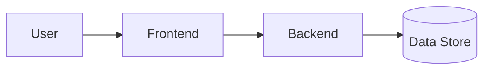

# Architecture

このドキュメントは、利用先プロジェクトの実アーキテクチャを定義するためのテンプレートである。

`docs/common/development-rules.md` に記載された標準スタックは、特に理由がない場合に採用するデフォルト構成として扱う。要件、制約、運用条件、チーム体制、既存資産、コスト、セキュリティ、拡張性などの理由で別構成を採用する場合は、このファイルに判断理由と影響範囲を記録し、人間の承認を得てから実装する。

## 採用アーキテクチャ概要

- TBD

## デフォルト構成との差分

標準スタックから変更するものがある場合、理由と影響範囲を書く。変更がない場合は「標準スタックを採用」と書く。

- Frontend:
- Backend:
- Infrastructure:
- Runtime:
- Auth / Hosting:
- Data Store:
- External Services:

## システム構成図

必要に応じて Mermaid で構成図を書く。

## Frontend

- 採用技術:
- 配置:
- 主要責務:
- メッセージ / 多言語対応:
- 未決事項:

## Backend

- 採用技術:
- 配置:
- 主要責務:
- API公開方式:
- エラーコード方針:
- 未決事項:

## Infrastructure

- 採用クラウド:
- IaC:
- 実行基盤:
- ネットワーク:
- 権限:
- 未決事項:

## Auth / Authorization

- 認証基盤:
- 認可方針:
- ロール:
- セッション管理:
- 未決事項:

## Data Store

- 採用サービス:
- 主なデータ:
- バックアップ / 復旧:
- 未決事項:

## External Services

- TBD

## Deployment / Hosting

- TBD

## Observability

- ログ:
- メトリクス:
- トレース:
- アラート:

## Security

- 機密情報管理:
- 監査:
- データ保護:
- 未決事項:

## Architecture Decision Records

重要な判断は、日時、選択肢、採用理由、却下理由、影響範囲を記録する。

### ADR-001: TBD

- 日付:
- 判断:
- 背景:
- 選択肢:
- 採用理由:
- 却下した選択肢:
- 影響範囲:

## 未決事項

- [ ] TBD
