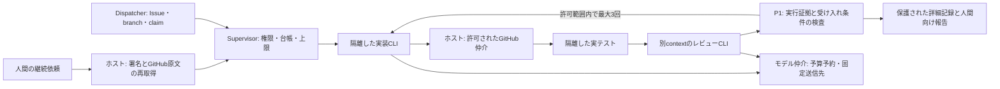

# 隔離Agent Runnerの設計

Runnerは、Dispatcherが確保したIssueを、実装・実テスト・別contextのAIレビューへ渡す任意の実行部品である。利用先アプリの言語は限定しない。管理ホストにはLinux、Node.js 22以上、Python 3.11以上、SQLite 3.35以上、Docker Engineが必要になる。

**開発中の機構であり、実サービスへの送信と無人実行は未採用。** 固定CLIとDockerの実境界は、外部AIへ接続しない模擬応答で検証する。書込みvolumeの実行中の総容量制限と、実providerの利用量・料金は未確認のため、production adapterは起動を拒否する。形式検査や模擬試験の成功でこの拒否を解除しない。

## 分担と実行の流れ

Supervisorの`accept`は、ホストが既に取得したP4の不透明handleだけを受け取る。候補選択を繰り返す常駐ループはP7、PRの組合せ検査はP6の担当である。workerにGitHub tokenを配布せず、公開操作はホストがP3/P4を通して行う。

最大2Issueを同時に扱い、各Issueは実装、検証、レビューの順に進める。AI枠が1なら順番に実行する。1件の実装失敗で、独立した別Issueの記録を捨てない。実装と検証の両工程が現在のclaimで許可されていない場合、このpipelineは開始せず、手動確認へ戻す。

## 依頼の本人確認

Runner固有のprofile/request/capability/attempt/usage/resultは`runner/v1`として独立させ、既存のIssue、execution、Project、GitHub、Dispatcherの契約を変更しない。

ホストのEd25519署名で、repositoryの数値ID、人間ownerの数値ID、run、profileのdigest、依頼元、本文digest、更新時刻、event、nonce、有効期限を束縛する。ホストは署名鍵をworkerへ渡さない。依頼の有効期間は最大60秒で、同じevent/nonceを再利用して重複起動しない。状況確認は台帳を変更しない。停止は通常作業より優先し、モデル送信を拒否する。

最初の具体的な依頼元adapterはGitHub Issueコメントである。`進めてください`、`再開してください`、`停止してください`、`状況を教えてください`など、受理する原文をAPIで再取得し、repositoryの数値ID、User、owner、write以上の現在権限、本文と時刻を照合する。引用、Bot、変更済みの本文、再作成された同名repositoryは受理しない。短い本文の対象run/profileはホスト側の署名付き記録で決める。

GitHubのUser判定だけで、端末を操作した物理的な人物までは証明できない。導入者は依頼元・署名発行サービス・鍵へのアクセスを管理する。AIがチャットの依頼をBotコメントへ転記したものは、nativeな本人確認の代わりにならない。未対応のチャット接続は未対応として止める。

## 隔離と送信範囲

候補adapterはCodex CLI **0.166.0 / Linux amd64**。公開archiveのSHA-256とbase imageをlockし、ビルド後はimage IDを固定する。版や必須能力が異なるadapterを自動採用しない。

workerはread-only root、UID/GID 1000、network none、capability全削除、no-new-privilegesで起動する。Issue別snapshotを読み取り専用mountとし、実装だけに承認された個別の書込みmountを追加する。レビューと検証ではコードを変更できない。ホストのHOME、認証ファイル、Docker socketを渡さない。独立したCLI session領域を持ち、レビューで実装のsessionを再利用しない。

snapshotに入れるファイルは明示入力だけとし、read_pathsとsend_pathsの両方、forbidden_paths、制御・credential用ディレクトリの除外を確認する。ファイルdigestだけで外部送信範囲を制御したと扱わない。ローカル専用のファイルはworkerへ渡さない。外部通信は、private Unix socketからホストのモデル仲介への接続だけを認める。

仲介先は固定したResponses endpointと承認済みmodelに限定する。remote tool、別URL、redirect、勝手な再送を拒否し、provider credentialはホストだけで使う。CLI側のweb search、追加agent、connector、hookなども無効にする。Issueやコードに書かれた指示で実行権限を拡張しない。

## 利用量・上限・停止

専用SQLiteで、依頼受理、attempt、AI枠、モデル利用量をtransactionで記録する。モデル送信前に、承認済み単価と最大入力/出力から最悪費用を予約する。providerの確定usageで精算し、結果・usage不明なら予約を維持して以後の送信を止める。workerが申告した費用で精算しない。費用枠0ではproviderを呼べない。

| 項目 | 実装の上限 |
| :--- | :--- |
| 同時Issue / AI枠 | 2 / 3。profileではさらに小さくできる |
| run / 呼出し / 後処理 | 6時間 / 30分 / 10分以内 |
| 自動修正 | 最大3回。変化のない失敗、承認待ち、既存blocked/failedでは停止 |
| CPU / memory / pids / scratch | 2 CPU / 2 GiB / 128 / 256 MiB以内 |
| 入力 / event / CLI log | 5 MiB / 1 MiB / 10 MiB以内 |
| 成果の収集 / 保存 / DB | 1attempt 100 MiB / 全成果1 GiB / DB128 MiB以内 |
| 履歴 / 台帳操作 | 10,000 attempts / 100,000 events以内 |

CPU/memory/pids/scratchはDockerで制限する。成果収集時の容量検査は、実行中の書込みvolumeやCLI sessionによるディスク消費を防ぐ保証ではない。この差を解消するquota対応のホスト構成と実境界試験が、production採用の前提になる。

DockerのHEALTHCHECKは、workerのevent loopが更新するheartbeatの鮮度だけを確認する。実行許可・費用・終了・工程成功の証拠としては扱わない。

モデル仲介のsocket切断・呼出し期限はホストのprovider helperにも伝え、終了を観測する。Linuxのparent-death signalで、supervisor強制終了時にもhelperを残さない。切断後にprovider側の処理や請求が取り消されたとは断定せず、利用量不明なら費用予約とP4の実行claimを保持する。

監視間隔は15秒。期限・権限・世代を確認し、停止時はTERMを送り5秒後にKILLする。containerのPIDと子プロセスの終了を確認できなければ枠・claimを解放せず、未確認として報告する。

## 証拠と修正反復

実テストは、P1 profileのdigestとcommand_idから取得した実行ファイル/argvを使い、shellを経由しない。最初の出力readerはNodeのTAPの件数に対応する。他のテスト形式は件数readerが必要であり、件数不明を成功として補わない。

終了したattemptの変更ファイル、削除、実出力を保護領域へ保存し、fsync後のdigestを台帳に束縛する。P1へ渡したテスト件数・終了code・commandを実出力と照合する。レビューは別worker/contextで実行し、最終メッセージからP1 review JSONを取得する。ホストが保存後に補うevidence_refs以外の内容は、実際のレビュー出力と一致させる。

既知のテスト失敗は、許可された修正の判断へ渡せる。未知の終了、CLI/protocol破損、上限、同じ失敗の繰返しは停止する。実装変更を公開する場合は、ホストの`publishTask`がP3/P4で反映し、更新されたheadを再取得する。旧headの検証・レビューを新headへ流用しない。

## 中断・再起動・復旧

単一ホストのwriter lock、FULL同期、世代、再起動時のrecovery barrierを使う。生存していたattemptや未精算usageがあれば、新しいworkerを起動しない。workspace、未push成果、container ID、claim/worker/generation、CLI contextの対応を保存する。

ホストの`reconcile`は現在のP4権限と停止を再確認し、保存workspaceを検査して成果を残す。全attemptの終了が確認でき、usage不明がなければ、復旧の照合を完了できる。再開には新しい認証済み継続依頼が必要であり、古い依頼を再送して実行し直さない。P4自体の復旧・handle再発行が必要なら先にP4で行う。

確認できたCLI sessionだけをimplementationに再接続する。session対応が不明なら、確認済み成果から新contextを準備し、同じCLI会話を復元したとは扱わない。終了不能、workspace破損、未知usageは手動確認へ戻す。台帳の行や費用を手で消して復旧しない。

## 人間が見る場所

共通の設計・仕様は本書、個別の承認・検証結果はIssue/PR、実出力や台帳はrepository外の保護領域を正本とする。GitHubには対象Issue/head、結果、診断、未評価、必要な判断、保護記録への参照を要約する。raw prompt、コード本文、provider応答、credentialを無条件に投稿しない。P6/P7による自動報告は別段階で接続する。

導入・検証コマンド、未採用の条件は[セットアップ](agent-runner-setup.md)を参照する。
