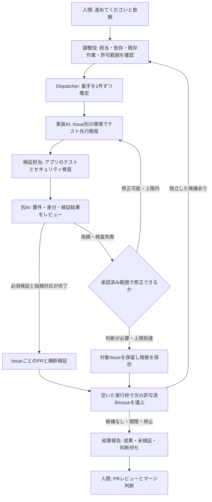

# 継続依頼を起点とする担当Issueの自律開発・検証・AIレビュー設計

## 1. 状態と採用方針

担当Issueを続けて進める際の既定値・設定変更・途中保存と再開は、[自律実行の設定・停止・再開の設計](native-continuation-design.md)を参照する。残量取得や機械的な自動停止は、設計の存在だけでは提供済みにならない。

本書の実行基盤・専用台帳に関する仕様は、該当する部品を採用する場合の技術資料である。日常の依頼・設定方法は運用マニュアルを参照する。検証・独立レビュー・権限/承認・人間のマージ判断に関する共通条件を維持する。

- 原設計: **設計承認済み（2026-11-03、gorillaimo）**。Issue #44の設計資料。この承認を追加設計や実装の承認へ転用しない。
- 承認対象: PR #45 head `30b4cbfdc8e65d5ae95699ad30ed12ab153bae81`の設計。[会話での人間承認を記録したIssueコメント](https://github.com/gorillaimo/ai-driven-dev-template/issues/44#issuecomment-6607335179)を参照。AIによる転記をGitHub本人のPR Reviewや実行用grantとは扱わない。
- 基準: PR #43マージ後のmain `991cefadf876a65f6bd51e9b26ac359ee44a21ce`。
- 本文は実装前の設計であり、機能の提供開始や実行許可を意味しない。コード・規約・既存schema・CI・VERSIONは変更しない。
- 人間の担当はGitHubのassignee。AI名は実行者の識別に使い、人間の責任者と区別する。

採用する方針:

1. 「進めてください」等の依頼を起点に、AIがGitHub Issue/PRと作業記録を調べ、依頼元の人間が担当するIssueから進められる作業を選ぶ。
2. 単一Issueでも使える検証・別AIレビュー・セキュリティ検査を先に整える。
3. 独自の管理基盤を採用する場合は、中央Dispatcherが着手を一元管理し、Issueごとに分離した環境で実行する。通常の会話開発は前述の設計に従い、既存GitHub記録で担当/競合を確認する。
4. 許可された工程を自律的に継続し、独立したIssueは並行に進める。対象や作業順を人間が毎回指定する必要はない。初期範囲は単一リポジトリで、実行量には上限を設ける。
5. 各IssueでPRを作り、一時的な統合環境で複数PRの組み合わせも検証する。
6. 必要な判断が生じたIssueは止め、独立していると確認できた他Issueを続ける。
7. 進捗の区切り、判断が必要なとき、今回の実行終了時に成果・証拠・残る問題を人間へ報告する。マージ・本番反映・Releaseは自動化しない。

**中心となる動作は、継続依頼→AIによる作業選択→可能な範囲で複数Issueを自律的に進行→人間への報告である。** 昼夜や人間の在席を条件にしない。「夜に依頼して朝に結果を確認する」は利用例の1つで、報告を朝まで遅らせたり、夜間用の別工程を必須にしたりしない。

具体的な上限値と最初のAIツールは後続実装と能力試験でも確認し、設計の合意と実行時の承認を分ける。既存の[Project統制設計](project-orchestration-design.md)・[Issue内部の設計](adaptive-workflow-design.md)を置き換えない。

P4の実装仕様・有限上限・移行/復旧の保証範囲は[Dispatcherの設計](dispatcher-design.md)を参照する。P4は管理部品を提供し、P5の実AI起動・隔離とP7の会話からの自律継続は別段階で接続する。

P5の開発中の実装仕様と未採用条件は[Runnerの設計](agent-runner-design.md)、検証・導入は[Runnerの準備](agent-runner-setup.md)を参照する。模擬応答による実CLI/Docker試験を、実AIの単一/2Issue試行や無人実行の承認と同一視しない。

P5は実験実装と実運用前検証に分ける。実験実装を先にマージしても、実運用前検証と個別の有効化承認が揃うまでproduction起動拒否・実モデル予算0・無人実行未有効を維持する。P6/P7の実装で部品を参照することと、実モデルを使う接続・自律運用の実証を区別する。

## 2. 人間とAIの流れ

図のDは実装変更の流れ。調査・設計だけを許可したIssueは、設計案の提示までで止める。FからIへ進めるのは、機械検査とAI所見の両方を確認した場合であり、AIの好意的な総評だけでは進めない。

図は今回の実行が終わるまでの流れを示す。途中にもPR準備完了・重要な問題・判断事項を報告する。人間から具体的なIssueや作業の指示があればそれを優先し、「進めてください」は唯一の定型句にはしない。

## 3. 役割・権限・記録の分担

| 担当 | 行うこと | 行わないこと |
| :--- | :--- | :--- |
| 人間owner | 目的、対象、工程、設計、上限、例外、PRを判断 | AIの検証成功だけでリスク受容を済ませない |
| 調整役AI | 候補・分担・統合案と報告を作る | 自分で実行権限や承認を増やさない |
| Dispatcher | 最新条件、排他、枠、操作履歴を管理 | 仕様判断や不明なclaimの自動解放をしない |
| 実装担当AI | 許可領域内のテスト・実装・修正 | 他Issueのbranchや共有設定を勝手に変更しない |
| 検証担当 | 固定したcommitで検査を実行し証拠を保存 | 未実行・非対応・ツール障害を成功にしない |
| レビュー担当AI | 別の実行コンテキストで要件・差分・証拠を確認 | 実装/テストの変更、人間承認、マージをしない |
| GitHub操作の仲介処理 | 許可されたbranchへのpush、PR・記録更新 | workerにGitHubの広いtokenを渡さない |

検証はコードと実装担当AIで兼ねてよい。別AIレビューは実装時の会話を引き継がず、同じモデルも使える。対象Issue・承認済み設計・差分・実テスト結果を渡し、実装担当の説明だけを根拠にしない。

| 情報 | 正本・保存先 |
| :--- | :--- |
| 作業契約、人間の担当、実際のPR、承認・着手の公開記録 | GitHub Issue/PR。通信不能時にローカルの推測で上書きしない |
| 静的な依存・領域・メンバー方針 | 承認済みProject設定と実行profile |
| Issue内部の工程と再開地点 | 既存Issue別plan/state・履歴 |
| 自動実行の排他・操作途中・実行者の世代 | Dispatcher専用の永続台帳。GitHub上の人間の担当を置き換えない |
| 検査、レビュー、統合結果 | commitと入力digestに結び付けた追記型の証拠。GitHubには安全な要約と参照を残す |

台帳は全workerが編集する共有Project stateにはしない。GitHub記録・台帳・Issue内部状態が食い違えば、対象の更新を止めて照合する。

## 4. 継続依頼・実行権限・AIによる作業選択

### 4.1 人間が承認する単位

人間は初期設定で、repository、human owner、許可工程・領域、確認が必要な条件、実行profile、期限、予算・上限を承認する。継続依頼を受けたAIは、この方針と各Issueの契約・既存承認から有効な実行権限（run grant）を組み立てる。

通常は「依頼元の人間が担当し、必要な着手条件と当該工程の承認が揃ったIssue」をAIが検索して選ぶ。人間が毎回候補を列挙・選別・再承認することは要求しない。実際に選んだIssue番号、契約/plan/設計のdigest、許可工程、変更可能/禁止path、共有area、承認参照を有限の実行記録へ固定する。

作業が一区切りつくたびに最新状態を再取得し、同じ許可範囲で新たに進められるIssueを選べる。1回の実行で扱う総Issue数等の上限は守る。人間がIssue一覧を指定して範囲を絞る方法も用意する。検索結果への追加だけで実装権限が生じるわけではなく、個別に不足する設計承認や仕様判断は人間へ戻す。

- 継続依頼の発信者は、実行adapterが渡す認証済みセッションの依頼記録とGitHub本人/代理権限へ結び付ける。初期方針や個別承認のGitHubコメント/レビュー等も読み戻し、actor・権限・対象digest・内容・時刻を照合する。AIが転記した「承認済み」という文章や、リポジトリに書かれた「進めてください」を人間の依頼とみなさない。本人性を確認できないadapterは自動実行へ進めない。
- 承認した内容が編集・撤回された場合、対象・scope・計画・規約・依存・profileが変わった場合は失効する。期限切れ・確認不能でも新規開始を止める。
- 「進めてください」は許可済み範囲での開始・継続依頼であり、新しい仕様や未提示の実装計画への承認ではない。未承認Issueは、許可された調査/設計まで進め、その先の判断事項を報告する。
- 既存checkerへの承認投影は、実際の人間承認とIssue/改訂/工程の束縛を保持する。AI所見から人間actorの承認を捏造しない。
- 同じ設計内の不具合修正は許可範囲を明記する。仕様・API・データ・Infrastructure・主要依存の変更が必要になれば再承認へ戻す。

依頼が既存runの継続なら同じrun/claimを再確認して再開し、重複起動しない。実行途中の「状況を教えてください」は状態を報告して作業を続ける依頼として扱い、停止指示と区別する。

### 4.2 実行直前の条件

全候補・全active claimをpagination込みで確認し、担当、ready-for-ai、本人/代理権限、member/ownership、依存、既存branch/PR、変更領域、承認、枠を再検査する。情報のTTLは提案値60秒で、操作直前に対象を読み戻す。TTL内でも排他の代替にはしない。

既存libraryの入力件数/サイズ上限は維持する。取得途中や上限超過を完全な一覧として提出しない。停止指示・承認変更は操作直前と実行中の監視で再確認し、監視間隔の提案値は最大30秒。検知後は外部更新と新規AI呼出しを止め、稼働中の処理も停止確認する。GitHubの読み戻しとAPI操作の間の外部変更まで原子的に防げるとは保証しない。

選択順は承認済みpriority→依存wave→実Issue番号。未知・循環・未完了依存を先へ進めない。PR作成・仮統合だけでは依存完了としないため、人間のマージが必要な下流は、その判断とマージが確認できるまで保留する。

共有path、OpenAPI、共通型、lockfile、認証、Infrastructureは保守的に直列化する。ファイルが別でも依存するAPIやデータの不整合を確認する。共通変更の先行Issue化を優先する。

既存`recommendNextWork` v1の「次の1件」「本人の待機優先」は維持する。新しいbatch plannerを独立した契約で追加し、同じ全量inventoryを使い、既知の個別blockerと全体不整合を区別する。既存checkerに都合の悪い事実を渡さない方法で並列化しない。

| 状況 | 扱い |
| :--- | :--- |
| 1件だけ仕様・承認待ち、他Issueと依存/領域の干渉なし | 当該Issueと下流を保留し、他の許可済み候補を選べる |
| 全量一覧が不明、actor/権限不明、台帳破損、重複claim | 新規開始を全体停止。原因が不明なまま候補を選び直さない |
| 共有areaの不整合 | そのareaと影響先を止める。影響範囲を確定できなければ全体停止 |

### 4.3 枠と提案上限

以下は初回試行用の**提案値**であり、この設計書によって実環境へ適用されない。

| 制限 | 提案 |
| :--- | :--- |
| 1回の対象Issue | AIが選択・記録する総数は最大10件。人間が指定した場合はその一覧内 |
| 同時に開発するIssue | 最大2件 |
| 同時AIプロセス | 最大3。レビュー用1枠を含めて数える |
| 1回の実行期限 | 開始から6時間、終了処理用の別枠10分 |
| 1回のAI呼出し/検査 | 原則30分。長い検査は事前に別値を承認 |
| 修正→再検証・再レビュー | Issueごとに最大3巡。進展なしはそれ以前でも停止 |
| 費用/利用量 | 人間が有限値と単位を設定するまで無人実行しない |

人間の`max_concurrent_issues`は別の上限。in_review/blocked等の未解除claimも従来どおり数える。PR待ちで実行枠が空いても、claim枠がなければ新規着手しない。10件を処理したい場合は、ownerの上限もその運用に合わせて事前承認する。AIが上限を引き上げない。

## 5. Dispatcherの排他とGitHub操作

初期案は、単一ホストの監督プロセスとSQLiteのトランザクション付き永続台帳。OSの排他も併用し、1 projectに書込み担当を1つだけ置く。複数ホストから同じDBファイルを共有する構成や、多拠点の自動failoverは初期範囲に含めない。

1. projectの排他とwriter世代を取得する。同じ台帳への別writerは起動を拒否する。
2. `run_id / operation_id / claim_id / worker_id / generation`を採番し、Issue・領域・枠をトランザクションで予約する。二重要求は同じoperationへ戻す。
3. 実GitHubの担当・承認・既存作業を再確認する。不明なら予約を保持して照合待ちにする。
4. branch・claim記録・statusの操作を順に記録し、応答後に読み戻す。全項目の一致後にのみworkerを開始する。
5. workerの結果を受け、現在の世代・scope・停止状態を確認してから、仲介処理だけが外部更新する。

内部の予約は原子的でも、GitHubの複数操作全体は原子的ではない。応答不明時に別operationを作って再送せず、実コメント・branch・PRを照合する。復旧不能なら人間へ戻す。

自動claim用の機械的なreceiptを新しい契約として定義し、GitHub actorと台帳operationへ結ぶ。既存の手動Markdown様式v1を勝手にparser入力へ昇格しない。既存の手動claimは移行時に人間が確認し、不明な記録は停止要因にする。

原子的な二重着手防止の保証範囲は、同じDispatcher/台帳に参加する操作。外部の人間や別ツールがGitHubを直接更新する可能性は残る。自動運用中の対象areaの割当担当を一本化し、逸脱を検出したら止める。

期限切れやheartbeat不足で自動stealしない。writer再起動時も新規開始を先に止め、旧workerの停止、未push差分、公開操作、保存済み結果を照合する。古い世代のworkerからの更新は仲介処理が拒否する。

## 6. 実行環境とAIツール

この章は実行基盤向けの技術要件である。利用中のAI環境での作業は、[環境能力の確認](native-continuation-design.md#2-開始時に確認する能力)と利用枠の停止条件に従う。

最初の候補は、利用者の管理するLinux実行ホストで、認証済みの会話からの依頼を受けて開始・再開するCLI型Runner。必要な起動操作は調整役AIが担当し、人間に毎回CLI操作を要求しない。最初のAI adapterはCodex CLIを候補とし、後続実装で能力試験を行って採否を確定する。Claude Code等は同じ契約を満たすadapterとして追加できる。

人間の継続依頼を受ける入口と、実際に処理を続ける実行ホストを分ける。定時起動や夜間専用の設定は基本動作の必須条件にしない。長時間実行を支えられない環境では、その制限を報告して許可された工程まで進める。

adapterには、起動・実行者識別・結果取得・停止確認・再開・利用量取得・許可領域・通信制限の能力を要求する。CLIの版、認証方法、非対話動作、利用規約、料金、上限を確認し、満たせない機能を対応済みと扱わない。チャット画面だけの利用は手動方式を継続する。

- Issue別のbranchと作業場所を分け、元の開発者の作業場所を流用しない。
- **worktreeはGit作業の分離であり、セキュリティ上の隔離ではない。** workerごとにコンテナ等の実行境界、書込みmount、通信先、資源上限を設ける。ホストの認証情報・Docker socketを渡さない。
- 通常の実装/テスト環境と、外部更新を行う仲介処理のcredentialを分ける。workerにmerge・本番・管理権限を与えない。
- 仲介処理はrepository・Issue・branch prefix・操作種別を照合する。GitHubのcontents権限だけでbranchごとの隔離ができるとは扱わず、main保護とbypass権限も確認する。必要な境界を満たせなければ無人の外部書込みを有効化しない。
- コマンドは承認済みprofileの実行ファイルとargvで指定し、AIの自由文やIssue本文をshell命令として連結しない。profile更新や依存取得時の実行コードもレビュー対象にする。
- 外部AIへ送るソース・差分・ログの範囲と送信先は実行承認に含める。secretや本番データを送らない。
- 料金の見積と実利用量を区別する。実装・レビュー・再試行を合算して予約枠を差し引く。金額上限を強制できないadapterは、その制限と代替上限を人間が承認するまで無人実行しない。利用量不明では新規呼出しを止める。
- タイムアウト/停止は子プロセスまで終了確認する。確認できない場合は、その環境とclaimを保持して再割当しない。

終了処理用の10分は成果・記録の保存と照合の枠であり、新しい開発やAI呼出しの延長枠ではない。緊急停止では短い猶予後の強制停止もadapterの能力試験に含め、確認不能を正常終了にしない。

AIツールのsandboxや利用量機能を推測せず、偽のadapterと隔離環境で境界を検証した後に、限定した実adapter試行へ進む。

## 7. 単一Issueでも使える検証・別AIレビュー

### 7.1 工程の適用

| 変更 | 検証 | 別AIレビュー |
| :--- | :--- | :--- |
| 軽微な文言修正 | 差分・リンク等、変更に適した確認 | 任意。省略理由を記録 |
| 通常の機能開発 | 受け入れ条件に対応するアプリの実テスト・build・型検査等 | 標準の必須工程として設計。省略には人間の例外承認 |
| 認証・データ・Infrastructure・複数Issue変更 | 上記と必要なセキュリティ/統合検査 | 専門観点を追加。該当する人間承認も維持 |

アプリの検証と、テンプレート運用のchecker/Golden Testは別結果にする。単一IssueではProject設定なしで検証・レビューの契約を使え、自動着手は有効にならない。

### 7.2 証拠と指摘の契約案

共通headerは、契約version、repository、issue/work ID、run/attempt、base/head SHA、plan/policy digest、生成主体、観測時刻、入力digest、証拠参照。検証結果は`passed / failed / not_evaluated / error`を区別する。

実検証はコマンドID・argvの安全な表現、環境/ツール版、開始/終了、exit code、実行範囲、必要なテスト件数、ログの保護参照を持つ。終了コードだけで検証内容を保証せず、空のテストや途中で止まった後続検査も確認する。

指摘は安定ID、対象commit・path/行、AC/仕様/規則、重大度、再現方法または根拠、影響、`open / fixed / disputed / accepted_risk`を持つ。改善提案と不具合を区別する。レビューの実行主体/別contextも記録し、未起動・中断・破損したレビューを成功扱いにしない。

### 7.3 修正・再検証・人間判断

- 機械検査の失敗と根拠のある指摘に対して、実装担当が承認済みscopeで修正する。レビュアー自身は実装を書き換えない。
- 修正後は失敗箇所だけでなく影響する回帰検査を行い、該当指摘を別AIが再確認する。`fixed`は実装担当の自己申告だけで確定しない。
- commitやprofileが変われば、関連する証拠を失効させる。変更されていない部分の再利用も入力同一性と依存範囲を証明して記録する。
- 検査の無効化、期待値/coverage/受け入れ条件を通すためだけの緩和、未承認の仕様変更は修正に含めない。
- 重大な未解決指摘、AIと実検証の矛盾、誤検出の判断、上限到達、進展なしは人間へ戻す。AI所見単独で機械検査のblockを解除しない。
- `accepted_risk`は人間の承認者・理由・適用範囲・期限を要求する。例外は元の指摘を消さず、期限切れや対象変更で再確認する。

許可済みの修正反復は、実行中のvalidation内のサブ工程として新しいattempt記録に残し、必須確認が終わるまで当該工程を完了にしない。既存stateがすでに`failed / blocked / awaiting_approval`なら、従来の人間確認・再開手順を省略して自動復帰しない。plan改訂が必要なら、旧証拠を保持して既存の改訂・承認規則へ戻す。

必須検証/レビューが不足する場合もdraft PRで状況を共有できる。レビュー可能とする条件とマージ可否は別であり、通常PRへ移せる状態でも人間のレビューを省略しない。

## 8. セキュリティの工程と検査範囲

### 8.1 設計時の確認と基本検査

対象アプリについて、守る情報・人間/ロール/テナント・信頼境界・公開入口・外部サービスと想定される悪用を整理する。Web/APIでは[OWASP ASVS](https://asvs.owasp.org/)の採用versionと項目を記録し、必要なAC・テストへ対応付ける。全項目をすべてのアプリへ強制しない。

| 検査 | 基本方針・ツール候補 | 実施時点 |
| :--- | :--- | :--- |
| 秘密情報の混入 | ローカルscanner。[Gitleaks](https://github.com/gitleaks/gitleaks)等を比較し、値をマスク | 差分/PR前、初回は既存履歴の採用範囲も確認 |
| 依存の既知脆弱性 | [OSV-Scanner](https://google.github.io/osv-scanner/supported-languages-and-lockfiles/)等。lockfile/SBOM、情報の取得時刻を記録 | PR・依存更新・定期再検査 |
| コードの静的解析 | [Semgrep](https://semgrep.dev/products/community-edition/)等。対応言語・規則・送信/telemetryを確認 | コード変更のPR前 |
| IAM/Infrastructure/イメージ | Checkov/Trivy等を対象形式に合わせて比較 | 該当変更・公開前 |
| 認証・権限・入力・情報漏えいの実テスト | 対象アプリのテスト基盤 | 実装時とPR前の回帰 |
| 動作中のアプリの検査 | [ZAP](https://www.zaproxy.org/docs/docker/baseline-scan/)等を比較。許可された隔離環境に限定 | 必要な公開前検証。PR前に可能なら実行 |
| AIによるセキュリティレビュー | 第7章の別AIレビューに該当観点を含める | 機能PR前、高リスクは専門観点を追加 |

ツール名は選定候補であり、導入・実行・検証済みとは扱わない。後続実装で公式仕様、対応言語、ライセンス、private repositoryでの利用条件、費用、通信先とデータ送信、固定versionを確認してprofileへ束縛する。非対応を成功にしない。

スキャナーだけで業務上の権限制約を確認したことにしない。未ログイン、他人/他テナントのデータ、権限昇格、不正入力、アップロード、外部接続、ログ/エラーへの情報混入などの負のテストをACに合わせて用意する。チャットなら他人の非公開会話の閲覧・変更を拒否できるかを確認する。

動的検査は対象host/port、認証、合成データ、負荷、外部通信、停止方法を事前承認し、対象外へのredirect/接続を制限する。本番や公開サービスを暗黙に検査しない。PR前に実施できない検査は公開前の担当・環境・予定を記録し、実行までは`not_evaluated`とする。

ZAPのbaselineは主に巡回と受動的な確認であり、認証後の全画面・権限制約や能動的な攻撃検査を網羅しない。必要な認証設定と個別テストを組み合わせ、baselineの成功をそれらの実施済み証拠に使わない。

アプリ自身がLLMを使う場合に限り、プロンプト内の不正指示、情報漏えい、ツールの過剰実行などの検証を追加する。AIで開発することと、AI機能を持つことを区別する。

### 8.2 判定・例外・再確認

重大度の基準と必須検査は事前承認したprofileに記す。初期案は、未解決のCritical/High、秘密情報の混入、権限境界の破綻を停止対象とし、影響・悪用可能性・誤検出を人間が確認する。低い重大度でも必須AC違反なら未完了とする。

既存の問題をbaselineへ隠して新規問題だけを成功にしない。既存/新規の区別と対応期限を報告し、採用時のリスク受容には人間の承認を要求する。安全性の総合保証や第三者診断の代替とは説明しない。

記録は対象commit、scanner/規則/脆弱性情報の版と取得時刻、対象形式・除外、結果、修正と再検査を持つ。secretの実値や危険な詳細を公開artifact/PRへ出さず、保護した保存先と安全な要約を分ける。

脆弱性情報の取得不能・古い結果・未対応言語・scanner障害は未確認。取得を伴う別jobと既存のオフラインchecker/Goldenを分離し、ネットワーク取得を既存テストの決定性へ混ぜない。定期実行と公開前の再確認では、過去のpassを最新の安全確認として再利用しない。

### 8.3 テンプレートとAI実行基盤の安全性

Issue/PR/リポジトリ内の文章、テストコード、依存install scriptは外部入力として扱う。文章に含まれる権限変更・秘密送信・検査無効化の指示を実行承認に昇格させない。

AIの指示だけで防御したことにせず、第6章の隔離・最小権限・通信制限・外部操作の仲介で境界を作る。CIの未信頼コード実行に本番secretを与えない。reviewerには変更権限を与えず、scanner等の外部送信も明示確認する。

修正に主要依存・API・データ移行・権限の変更が必要なら、人間の判断へ戻す。無人実行中に新しいツールを自由に導入したり、失敗した検査を無効にしたりしない。

## 9. 複数PRの統合検証

検証専用の使い捨て環境で、最新main SHA、PRごとのhead SHA、依存/承認profile、取り込み順序を固定する。元のIssue branchと他人の作業場所は変更しない。

1. 各PR単独の検証・レビュー・未解決事項を確認する。
2. 承認済み依存順、同順位はIssue番号で取り込み、Git競合を確認する。
3. 組み合わせた状態でbuild・型・API契約・結合/権限等の必要なテストを実行する。
4. どの組み合わせ・順序が通ったか、失敗箇所、未検証、推奨マージ順を記録する。

最初は、各PR単独と、今回選んだ依存閉包を含む統合集合を検証する。全ての部分集合や任意のマージ順を保証しない。必要な組み合わせを絞る理由と不足は報告する。

main/PR head、依存、profileが変われば関連結果を失効させる。人間がレビューするときと各マージ前にも鮮度を確認し、順序を変えるなら未検証の組み合わせを再検証する。

競合修正は元Issueの担当へ戻す。一時統合branchの修正だけで解消済みにせず、元branchへ修正→個別検証/再レビュー→統合やり直しの順にする。仕様変更が必要なら人間へ戻す。

GitHubにはcommitに束縛した要約を接続する。required checks・branch protection・マージ設定は勝手に変更しない。CI成功、AIレビュー成功、統合成功を人間承認へ読み替えない。

### 9.1 P6の契約と実行境界

`tools/workflow-integration` は計画と実行を分ける。`planIntegration({profile, request})` は副作用のない計画関数であり、`authority: false` を返す。`integration/v1` のprofile/request/plan/resultを用い、既存の `execution/v1` や `github/v1` の受理範囲は変更しない。

profileはrepository/owner、承認済みexecution profileへの参照、検査image、固定command、必要な検査分類、資源上限、期限を定める。requestはmainとPR heads、各Issueのplan digest、依存、bundle digest、任意の明示順を指定する。plan digestはこれらと検査集合・順序・ケースを束縛する。

順序は依存を先に、同順位はIssue番号の昇順とする。明示順も依存に反すれば拒否する。各PRの依存を含む集合と、選定PR全体を検査し、同一集合は重複させない。不足依存・循環・重複PR・未知入力は停止する。初版は同一repositoryのPRを対象とし、fork/submodule/LFS等の未対応入力を成功にしない。

`openIntegrationController` はtrusted hostが設定する。P6 profileの承認、P4のopaque task handleと現在のclaim/世代、P3のopaque capability・担当・ready・対象・期限を開始時、各検査前後、報告直前に再確認する。hostのcallbackは信頼の起点であり、workerのJSONやrepositoryの文書から作成しない。合成authorityは実人間の認証を証明しない。

### 9.2 検証専用の隔離adapter

hostが承認したcommitから用意したGit bundleを受け取り、digest・サイズを照合する。取得やbundle生成をworkerに任せず、利用中のworktreeや `.git/config` を使い回さない。bundle展開と固定argvのGit処理は上限付きtmpfs内で行う。hook/filter、外部Git設定、replace/lazy fetch、Gitネットワークを利用しない。`merge-tree --write-tree` と固定した一時commitから、通常ファイルだけを取り出す。

アプリの検査は別のコンテナで、取り出したソースをread-onlyでマウントし、固定executable/argvをshellなしで実行する。ネットワーク、credential、Docker socket、hostの書き込みvolumeを渡さない。永続worker/session volumeを使わない検証専用adapterであり、P5のモデル実行Runnerの採用条件を迂回しない。通常の会話による開発にDockerを必須化しない。

初期hard capは次のとおり。profileは上限を下げることだけを許す。

| 対象 | 上限 |
| --- | --- |
| 入力 / 結果JSON | 5 MiB / 1 MiB |
| PR / ケース / 同時実行 / command数 | 10 / 11 / 1 / run全体100 |
| command / run / cleanup | 30分 / 6時間 / 10分 |
| CPU / memory / pids | 2 / 2 GiB / 128 |
| 書き込み一時領域 | tmpfs合計256 MiB、永続worker書き込みvolumeなし |
| bundle | 200 MiB |
| ソース | 10,000ファイル、1ファイル10 MiB、合計100 MiB |
| 保護ログ / artifact / run全体artifact | 1ケース10 MiB / 1件100 MiB / 1 GiB |
| 公開要約 / 実モデル予算 | 32 KiB / 0 |

さらに既存P3のAPI/page/時間/journal上限を適用し、P6の権限・鮮度確認はrun全体400回、報告操作IDは10件に制限する。上限に達したら対象を絞って新しいrunを準備する。設定値だけで隔離を確認済みにせず、コンテナ設定・cgroup・tmpfsを実行時に照合する。機能不足・故障・停止不能はblocked/未評価として扱い、hostでのアプリ実行へ切り替えない。

### 9.3 結果・失効・公開

Git競合と各commandの結果を区別する。必要な分類の検査がない場合や必要なテスト数に達しない場合は未評価とする。status、実行したケース、source/tree/commit digest、保護ログ参照、元IssueとACへの修正要求を記録する。停止・失敗で未実施のケースや、全部分集合/別順序の未検証も報告する。

main/head/依存/plan/profile/検査集合/image/順序の更新で、関連結果を失効させる。予定どおり先行PRがマージされてもmainが変わるため、残りを再計画・再検証する。保存した過去の証拠は削除せず、現在の鮮度と区別する。

詳細ログと結果はrepo外の保護領域へ不変ファイルとして保存する。`execution/v1 integration-result` への投影は、実際に保存できた参照と元のexecution profileを用いる。記録のschema適合だけで、実行や人間承認を証明しない。

実行前にprofile/request/planを保存し、途中の結果も未評価のcheckpointとして不変保存する。使用済みのrun保存先は自動的に再利用しない。host停止後は残存コンテナ・停止・公開成否・pinsを人間または承認した復旧手順で照合し、lockだけを削除して再開しない。host喪失後の自動停止・復旧をこの実装の試験だけで確認済みとしない。

人間向け報告は対象Issueへの追記コメントとする。`github/v1 append_record` に自由本文を追加せず、報告専用の `github/v2 operation/receipt` と別journalを使う。公開にはP3権限に加え、保存済み結果と正確な操作に束縛したhost内部のpermitを必要とする。型と上限を確認した値から要約を生成し、raw log/diff/ソース/環境変数は転載しない。送信前に永続化し、応答不明は読戻しを優先して盲目的な再POSTを行わない。

v2要約は権限の証拠ではない。既存v1 collectorが識別できないコメントは、既存の明示mapping手順で非claimとして確認するまで後続の権限判定を保留する。v1の未知情報の扱いを緩めて継続しない。P6単独では常駐起動、実モデル、production Runnerの採用、マージ設定の変更を有効化しない。

## 10. 停止・復旧と人間への報告

| 事象 | 停止範囲と復旧 |
| :--- | :--- |
| 仕様不明・承認失効・修正上限 | 当該Issueと下流を保留。証拠と判断事項を保存 |
| 検証/レビュー失敗 | 不具合と検査基盤の障害を区別。許可済み修正だけを上限内で再試行 |
| 全体予算・期限・人間の停止 | 新規開始を止め、安全な境界へ停止。終了確認不能ならclaimを保持 |
| actor/権限/全量性が不明、台帳破損 | 全新規操作を停止。元記録を保ち、人間と照合 |
| GitHubの部分失敗・応答不明 | operationを保持して読み戻す。二重投稿・新claimでの再送をしない |
| worker/監督プロセス障害 | プロセス停止、未push差分、保存済み結果、外部更新を確認して同attemptの再開可否を判断 |
| assignee/claimの無断変更、古い世代 | 対象更新を拒否し照合。勝手にownerを書き換えない |

手動へ戻す際は自動の新規割当を止め、全worker停止・未反映差分・操作途中を確認し、旧claimの維持/解除/引継を人間が判断する。台帳や記録を消して再起動しない。解除だけでIssueを完了にしない。

報告は特定の時刻に固定せず、次の契機で行う。

- 開始・再開時: 確認した現在地、選んだ作業、既存の許可範囲、必要な確認事項を簡潔に示す。新しい判断が不要なら、その報告への返答を待たずに進める。
- 作業の区切り: PR準備完了、重要な問題・新しいリスク、判断待ち、計画変更などを報告する。1件の報告待ちだけで独立した他Issueを一律停止しない。
- 人間からの状況確認: 現在の進捗と停止理由を答え、停止依頼がなければ許可済み作業を継続する。
- 実行終了時: 許可された作業の完了、実行可能な候補がない、承認待ちだけになった、上限到達、人間の停止などの理由と結果をまとめる。報告のために朝や指定時刻まで待機しない。

結果にはrun ID/期間/承認参照/実際の利用量、IssueごとのPRとhead、検証・レビュー・セキュリティ・統合結果、修正履歴、未解決・未検証、判断待ち、推奨マージ順を含める。GitHubの指定した作業記録と保護artifactを使い、外部メッセージ送信は既定で行わない。

「PR準備完了」はレビュー待ち。Issue完了・依存解除・claim解放は別の確認であり、PRができただけで自動完了にしない。

利用例: 日中に依頼して作業が一区切りついた時点で報告を読む場合も、夜に依頼して保存済みの報告を翌朝読む場合も、同じ選択・実行・報告の契約を使う。

### 10.1 継続制御の実験実装（continuation/v1）

`tools/workflow-continuation/`は、trusted hostが受け取った合成依頼から、候補の再選択と実行・検証・報告を管理するlibraryである。P7の実運用接続・実モデル試行とは分けて提供する。native/production adapterはなく、会話サービスの常駐起動や実GitHubへの新しい一般run投稿は有効化しない。

`planContinuation`は全量入力を既存P4 plannerへ渡す純粋関数で、authority:falseを返す。登録済みopaque adapterを使う`openContinuation`がaccept/tick/status/stop/reconcile/closeを提供する。本人確認と自由文の解釈はhost側で行い、source/event/nonce、repo/owner、parent run、方針/profile digest、期限、対象Issueへ依頼を束縛する。具体指示は範囲を絞る場合に受け入れ、未承認の拡大を拒否する。

区切りと最大30秒間隔で全量の候補/claim/PR/main/権限を確認する。既知の局所保留では独立候補を継続し、全体不明・権限喪失・上限では新規開始を止める。PR準備完了は依存完了ではない。claimの原子的予約・世代・解除はP4が管理し、P7には実行batchと照合記録だけを保存する。

P5の1回のacceptは選択済み最大2件を扱う。P7はparentとbatchを対応付け、既存の再送防止を変更しない。P5の修正は元Issue/branchで最大3巡、進展なしなら早期保留とする。P6失敗の元Issue/ACへの修正要求を残し、欠落・失効・未評価を成功にしない。4工程の証拠と別レビューcontext、Issue/plan/head/profile、PRと最新mainでのP6結果が揃う範囲だけreview_readyとする。main更新時は古い成功を失効させる。

専用のcontinuation/v1はprofile/request/decision/checkpoint/reportを定義する。repo外の0700保存先で単一writerとdigest chain付きjournalを使い、副作用前のintent、sending、confirmed/unknown、保護記録参照を保存する。不明な利用量・公開成否・起動は予約を保持してreconcile_requiredへ移る。再起動時も照合を必要とし、新依頼だけで期限・件数・予算をリセットしない。停止後の外部通知は行わず、返却reportと保護記録へ理由を残す。

| 対象 | hard cap（profileは引下げのみ） |
| --- | --- |
| 入力 / 出力 | 5 MiB / 1 MiB |
| 総Issue / 同時Issue / worker | 10 / 2 / 3（レビュー含む） |
| run / cleanup / call | 6時間 / 10分 / 30分 |
| 修正 / 空候補観測 | 3巡、進展なしは早期保留 / 2回でwaiting |
| 観測・権限確認 / 副作用 / report | parent全体400 / 100 / 100 |
| journal / event / 保護記録 | 32 MiB / 10,000 / 100 MiB |
| 公開要約 / 実モデル呼び出し・provider予算 | 32 KiB / 0・0 |

合成利用量はcalls/cost_unitsをbatch前に予約し、既知結果だけを精算する。全batch・修正・レビューをparent単位で合算し、再送/再開で復活させない。実料金の検証ではない。

人間向けreportは期間・権限設定digest、Issue/PR/head、工程証拠のdigest、修正回数、保留・残作業、参考マージ順、合成利用量、未評価、checkpoint参照を含む。raw log/diff/ソース/環境変数は保護領域だけに置く。APIと合成portの詳細は[ツールREADME](../../tools/workflow-continuation/README.md)、記入例は[continuation/v1](../../.ai-workflow/templates/continuation/v1/README.md)を参照する。

合成E2Eは実際のP3/P4/P5/P6 libraryをfake基盤で通す。native本人性、親子run権限委譲、実利用量・料金、一般runのGitHub公開、host喪失時cleanup、保管期限、実モデル立会い/限定自律試行は未評価である。合成hostのallowedや署名を本番の本人確認へ転用しない。後続の実運用検証と個別の採用承認を必要とする。

## 11. 互換性と変更する契約

- `AGENTS.md`と`development-rules.md`はlegacy always-onとして維持する。自動実行が有効でも、人間指示、Issue契約、必要承認、TDD、Quality Gates、scopeを優先する。
- 既存rule/check/trace/project/Golden/CIのv1受理集合・結果は変更しない。v1推薦を複数選択へ流用しない。
- 実行profile、run grant、検証/レビュー/セキュリティ/統合結果、run report、操作eventには、独立したexecution契約を新設する案とする。`.ai-workflow/schemas/execution/v1/`、記入例は同じnamespaceのtemplatesへ置く。
- Project v1は`coordination_mode: manual`だけを受理する。v1へ`dispatcher`を書いて通さない。自動着手の導入では、Project schema v2と専用の検査・明示移行PRを別途実装する。team/delivery-plan等の対応versionと相互参照を移行Issueで固定する。
- Project schema v2とexecution schema v1は成果物契約の版であり、template本体のRelease versionとは別に管理する。
- 移行は既存claim/branch/PR/権限を照合し、対象areaの手動操作担当を止めてから切り替える。旧checkerが新versionを拒否することを正常な非対応として扱い、黙ってmanualへ落とさない。
- 第7〜8章の共通検証だけならProject v2は不要。既存Issue工程のvalidation/handoffへ証拠参照を結び付け、新しい結果契約で判定する。既存stage名や承認履歴を無断で変えない。
- 利用先アプリの言語は限定しない。管理コードはNode.js 22以上を基本候補とし、検査・AI adapterは外部能力として明示する。

変更予定の本体は、新規設計書と既存設計/CHANGELOGの参照だけ。後続実装の変更候補は次章に分ける。利用先の実Project設定、実grant、共有stateは公開元へ作らない。

v2 stableの現在の必須条件は[versioning-policy](versioning-policy.md)第5章を維持する。Dispatcher/Runnerは任意拡張とし、本設計だけでstableの必須範囲や公開時期を変更しない。セキュリティの実施範囲・既知制約をRelease判断で明示し、未提供の検査や無人実行を利用可能と宣伝しない。

## 12. 後続実装計画

P1〜P7は計画項目IDであり、GitHub Issue番号ではない。設計承認後に発行した実装Issueは以下のとおり。各Issueの発行は、依存完了・個別の実装設計承認・実環境の有効化を意味しない。

| 項目 | 実装Issue | 主な着手前提 |
| :--- | :--- | :--- |
| P1 | [Issue #46](https://github.com/gorillaimo/ai-driven-dev-template/issues/46) | PR #45のmain反映 |
| P2 | [Issue #47](https://github.com/gorillaimo/ai-driven-dev-template/issues/47) | #46 |
| P3 | [Issue #48](https://github.com/gorillaimo/ai-driven-dev-template/issues/48) | #46 |
| P4 | [Issue #49](https://github.com/gorillaimo/ai-driven-dev-template/issues/49) | #48 |
| P5: 実験実装 | [Issue #50](https://github.com/gorillaimo/ai-driven-dev-template/issues/50) | #47・#49。課金なしの試験・CIと未採用条件まで |
| P5: 実運用前検証・採用判定 | [Issue #66](https://github.com/gorillaimo/ai-driven-dev-template/issues/66) | #50のmain反映。実運用が必要になった時点で個別設計・試行承認を得る。現在は保留 |
| P6 | [Issue #51](https://github.com/gorillaimo/ai-driven-dev-template/issues/51) | #47・#48。Runner部品の接続は #50、実モデル・production接続の実証は #66 の採用判定後 |
| P7 | [Issue #52](https://github.com/gorillaimo/ai-driven-dev-template/issues/52)、合成実験は[子Issue #68](https://github.com/gorillaimo/ai-driven-dev-template/issues/68) | #50・#51。実モデルの限定自律試行と実運用の有効化は #66 と個別承認が前提 |

| 項目・依存 | 目的・主な変更候補 | 受け入れ条件・先行テスト |
| :--- | :--- | :--- |
| P1: 共通契約 | execution schema/templates、専用read-only検査、採用後の規約/手順 | 単一Issueの検証/別AIレビュー/指摘/例外をcommitへ束縛。未実行・破損・古い成功を拒否。正常/失敗/失効/誤検出fixtureを先に作る |
| P2: セキュリティと検証接続。P1後 | 検査profile/adapter、アプリ別設定例、独立CI job、quality-gates/運用案内 | 合成secret/依存/危険設定・権限負のテスト例、scanner障害/非対応/古いDB、規則緩和拒否。オフライン検査を維持し、限定した実scanner試行も確認 |
| P3: GitHub取得・操作境界。P1後 | collector/broker、snapshot/操作receipt、auth/permission/取得上限 | 全量pagination、担当/承認改変、API応答不明/再送、外部入力の不正指示、path/branch逸脱。偽APIの失敗テスト後に試験repoで限定実証 |
| P4: 自動着手。P3後 | Project v2/移行、batch planner、Dispatcher/永続台帳 | 二重要求、複数writer、area/capacity、世代、途中再起動、手動記録との不一致。実並行プロセスで1件だけ確定することを検証 |
| P5: 依頼から開始・再開するRunner。P2/P4後 | 認証済み依頼との接続、adapter契約、最初のCLI adapter、隔離/停止/予算・利用量 | #50でfake/模擬応答と実CLI/Dockerの課金なし試験。#66で永続容量制限・実人間source/署名運用・実usage/料金と能力試験→単一Issue→2Issueの実AI試行を確認。必須能力なしでは起動拒否し、#50のマージだけで採用しない |
| P6: PR横断検証・報告。P2/P3後、実行接続はP5後 | 一時統合環境、結果/鮮度検査、GitHub要約/保護artifact | 単独成功・統合失敗、Git/API/権限の競合、head/main更新、順序変更、元branchへの修正反映。組み合わせの保証範囲を確認 |
| P7: 会話起点の自律継続と報告。P5/P6後 | 許可範囲内の候補抽出・継続選択、区切り/判断待ち/終了時の報告、停止/再開 | 候補を人間が指定しない継続依頼、作業完了後の次候補選択、1件保留で他Issue継続、全件待機、期限/費用/権限喪失、途中障害・手動復帰を試す。日中/夜間で同じ動作を確認。定時起動は必要時に別有効化 |

各項目で、対象・変更予定ファイル・必要な権限/予算・テスト・人間承認を改めて提示する。既存CIへ実秘密や常時LLM課金を持ち込まず、追加CI/required checksも明示採用する。

## 13. 設計の検証と受け入れ条件

本Issueは設計の整合・シナリオ確認を行う。次表の動作テストは後続実装の要件であり、本設計書や既存1267件の成功で実証したとは扱わない。

| シナリオ | 期待する結果 | 実装項目 |
| :--- | :--- | :--- |
| 独立2Issue、同じ人間owner | 許可範囲で並行、別PR、実行枠とclaim枠を別管理 | P4/P5/P7 |
| 「進めてください」だけでIssue未指定 | 既存の方針・個別承認から候補をAIが選び、不要な再承認待ちなしで継続 | P3/P4/P5/P7 |
| 日中の依頼、終了・判断待ち、途中の状況確認 | 時刻に依存せず報告し、状況確認だけで停止/重複起動しない | P5/P7 |
| 1件承認待ち、依存/共有領域なし | 対象を保留し、許可済み他Issueを継続 | P4/P7 |
| 未完了依存、循環、全量不明 | 依存を迂回せず停止。全量不明は全新規開始停止 | P3/P4 |
| 同時claim・writer再起動・応答不明 | 二重確定/二重副作用を防ぎ、途中記録を保持 | P3/P4 |
| 仕様・担当・承認・scope改変 | grantを失効し、新規副作用を止める | P1/P3/P4 |
| テスト成功でもAC漏れ、別AI未起動 | 根拠付き指摘/未評価を残し成功へ昇格しない | P1/P5 |
| 修正上限、同じ失敗、誤検出 | 検査を弱めず、人間へ判断を戻す | P1/P5/P7 |
| secret/既知脆弱性/権限違反、scanner故障 | 問題・未確認を分けて止め、値を公開しない | P2/P6 |
| 単独pass・統合fail、順序/head変更 | 組み合わせ結果と証拠を失効させ、再検証 | P6 |
| 不正指示、sandbox越境、利用量不明 | 外部操作や新規呼出しを拒否 | P3/P5 |
| kill/未push/古いworker、期限切れ | 成果・claimを保ち、確認なしに再割当しない | P4/P5/P7 |
| 従来v1/Projectなし/非対応AIツール | 既存運用を継続し、新機構の未実行を明示 | P1/P4/P5 |

| Issue #44のAC | 本文で具体化する箇所 |
| :--- | :--- |
| AC1: 役割と流れ | 第2〜3章 |
| AC2: 選択・承認・継続 | 第4章 |
| AC3: 排他・隔離・別PR | 第5〜6章 |
| AC4: 横断検証・鮮度・修正 | 第9章 |
| AC5: 基盤・上限・復旧・報告 | 第4.3・6・10章 |
| AC6: 互換性・変更対象 | 第11〜12章 |
| AC7: 実装順・テスト | 第12〜13章 |
| AC8: 品質・未決事項・人間承認 | 第8・11・14章 |
| AC9: 共通の検証・別AIレビュー | 第3・7・11章 |
| AC10: 指摘・反復・失効・停止 | 第7・9〜10章 |
| AC11: アプリと基盤のセキュリティ | 第6・8章 |
| AC12: 未評価・例外・定期・CI段階導入 | 第8・12〜13章 |

## 14. Quality Gatesと実装前の確認事項

| Gate | 設計で扱うこと | 未実証・後続で確認すること |
| :--- | :--- | :--- |
| NFR | 候補/並行数、時間、費用、API全量/鮮度、検査組み合わせの上限 | 実API量、台帳/起動/終了時間、adapterの課金/資源制限と実案件性能 |
| Security | 人間承認、最小権限、隔離、scanner/負のテスト、別AIレビュー、秘密の保護 | 実ツールの対応/通信/版、実sandbox境界、実アプリの脆弱性と修正品質 |
| Resiliency | 排他、操作ID、世代、途中記録、停止/再開・手動復帰 | 実同時実行、電源断/API障害、子プロセス停止、未push保存・引継ぎ |

本設計では、継続依頼を起点にAIが許可範囲内の担当Issueを選んで進め報告する方式、実行量と権限の上限、既存v1から分離した自動方式、共通検証/別AIレビュー/セキュリティ工程、段階実装とその保証境界に合意した。次の詳細は実装Issueで提示・確認する。

- 最初のadapter候補と能力試験結果、具体的な実行基盤/隔離方式。
- 第4.3章の提案値、実際の費用上限・単位・観測/強制方法。
- 検査ツールと固定version、言語/規則/重大度基準、通信/送信範囲、結果の保存期間。
- Project v2移行と既存記録の照合、担当/領域の調整、GitHub権限・checksの採用。

設計の合意だけで実環境のgrant・token・無人実行を有効化しない。具体的な実装方針・変更ファイル・先行テストを提示し、人間の承認後に各実装へ進む。
