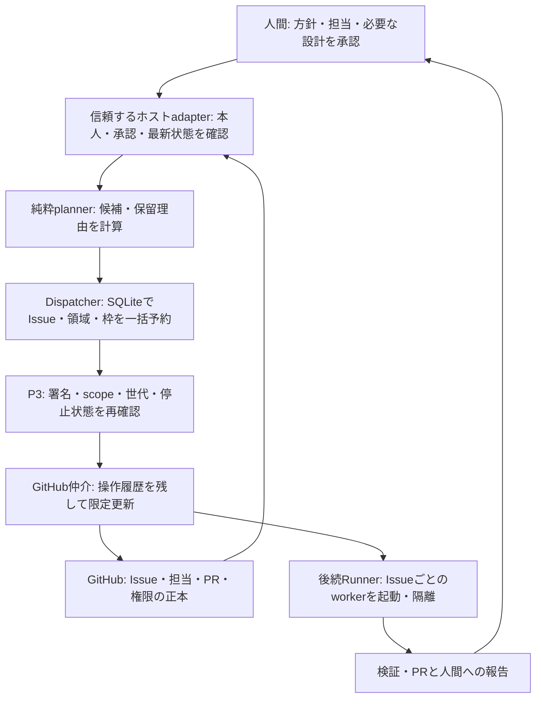

# Dispatcherの設計と保証範囲

Dispatcherは、承認済みの担当Issueから並行着手できる候補を選び、重複着手と共有領域の競合を防ぐ管理部品である。利用先アプリの開発言語は限定しない。Project v1の手動運用と読み取り専用推薦は、そのまま利用できる。

提供するのはProject v2契約、候補選択、単一ホストの排他台帳、既存GitHub仲介への接続、明示的な移行・復旧である。AIプロセスの起動・隔離、会話の本人確認adapter、自律継続ループは後続のRunner・進行制御で接続する。この部品だけで「進めてください」から無人開発を開始することはない。

## 役割と入口

| API | 役割 |
| --- | --- |
| `validateProjectV2(configuration)` | Project/team/delivery-planの形式、参照、改訂、digest、DAGを検査 |
| `planBatch(request)` | 副作用なしで候補と保留理由を返す。`authority: false` |
| `previewMigration(input)` | v1または未導入からの移行を照合する。権限付与なし |
| `createDispatcherAuthority(ports)` | 信頼するホストコードが本人確認・観測adapterを登録 |
| `openDispatcher(options)` | 台帳とP3を接続し、予約・限定操作・引渡し・停止・復旧を管理 |
| `openStore(options)` | 信頼するcontroller向けの低水準保存API。承認やworker公開APIではない |

配置は`tools/workflow-dispatch/`。Project v2 schemaは`.ai-workflow/schemas/project/v2/`、予約・入力・結果のschemaは`.ai-workflow/schemas/dispatch/v1/`。この2つのversionは独立している。既存Project v1のschema、validator、`recommendNextWork`は変更しない。

## Project v2と候補選択

`project`、`team`、`delivery_plan`をすべて`schema_version: 2`とし、`coordination_mode: dispatcher`を明示する。`runtime_backend: issues`のみ対応する。これはGitHub Projects製品の設定ではない。`repository`と数値`repository_id`、team/delivery-planのrevisionと内容digestを束縛する。組織Teamからの動的membership取得には未対応である。

入力は、明示的な実行profile/grant、全量かつ新鮮なGitHub snapshot、Issue別の承認・blocker・priority・関連PR、制約ごとの照合結果、台帳で構成する。snapshotと権限の鮮度は60秒。入力内の`approved`等の値だけで実行権限は成立しない。

候補は担当人間のmembership・現在のrepository権限・Issue assignee・ready-for-ai・個別承認・契約digest・profile scopeを満たすものに限る。明示されたIssue指定は候補集合を狭め、停止条件を迂回しない。指定外も含めgrant全体の契約変更を検出する。

順序はpriorityの小さい順、依存DAGのwave、Issue番号で決定する。priorityは最新のIssue観測値を使い、delivery planのplanned_priorityを最新情報の代わりにしない。依存featureは必須Issueがすべてclosed、対応PRが同一repositoryでmergedかつclosedの場合だけ完了と扱う。PRがレビュー可能になっただけでは完了しない。

既知の個別blocker、承認待ち、領域・枠の不足は当該Issueを保留し、独立した候補を続ける。未知の依存・循環、全量不明、古いsnapshot、重複claim、未照合の外部操作、変更された設定は全体を停止する。外部依存・承認・共有領域制約には、対象内容digestに一致する現在の制約観測が必要である。

変更パスが重なる場合は領域名が違っても競合する。また、sharedまたはserializeの領域に変更パスが触れる場合、feature側に領域名の指定がなくても予約対象へ加える。plannerと保存層の両方で検査する。

## 排他台帳

Linux単一ホスト上で、Nodeから固定Python子プロセスを起動する。Python 3.11以上、SQLite 3.35以上、標準`sqlite3`と`fcntl`を用いる。Python選択、環境変数、コマンド、SQLは固定し、workerから任意SQL・shell・credentialを受け取らない。

保存先はrepository外の専用ローカルdirectoryで、所有者限定0700、ファイル0600とする。symlink・hardlink・不適切な所有権を拒否する。ネットワークファイルシステム、複数ホスト、外部workerによる直接書き込みは保証対象外。同一OSユーザーの悪意ある別プロセスからの隔離も、この部品単独では提供しない。

writerは接続期間中`flock(LOCK_EX|LOCK_NB)`を保持する。lockファイルを終了時に削除しない。SQLiteは`journal_mode=DELETE`、`synchronous=FULL`、foreign key有効、1秒busy timeoutとする。Issue予約、領域予約、実行枠、run累積件数、履歴は1トランザクションで確定する。GitHub更新はこのトランザクションには含まれない。

同じoperation IDと同じ内容の要求は保存結果を返し、内容が変われば拒否する。呼出側のdigestだけを信用せず、実際の要求を照合する。active Issueの一意制約を持ち、writer再接続ごとに永続世代を増やす。旧世代・別workerの更新は拒否する。

`in_review`と`blocked`も未解除claimとして人間の上限と領域予約に数える。実行枠はworker停止を確認してから解放する。claim・領域は明示的な解除まで保持する。run累積件数は解除後も減らさず、期限やheartbeat不足で自動的に予約を奪わない。

## 権限とGitHub操作

controller authorityとtask handleはプロセス内の不透明なオブジェクトで、WeakMapに登録する。JSON、repository文面、workerの結果から復元できない。低水準store APIをworkerへ渡してはならない。

ホストadapterは、現在の承認・観測、移行承認、worker停止・解除、復旧確認を検証する信頼境界である。登録callbackの返すbooleanはホスト検証結果であり、外部JSONをそのまま返す実装を採用してはならない。具体的な本人確認adapterとworker隔離は後続実装で定める。

P3の署名検査を実際に呼び、profile・契約・設計・パス・工程・head・policyを予約へ束縛する。`execution.reserved/generation/stopped`は、ホストcallbackの値を上書きし、SQLiteから読み直す。P3の各更新直前の確認でも停止・世代・期限を確認する。stopは待ち行列の外からrunを停止できるが、worker終了や予約解除を意味しない。

送信前にSQLite outboxへ記録し、既存P3 journalへreceiptを保存する。branch作成とclaim記録をそれぞれ読み戻して確認した後だけreadyへ進める。worker起動は行わない。

`synthetic`は合成検証であり、実人間の本人確認・live GitHub・worker隔離を未評価として返す。`production`は既存P3の実transportを要求するが、この条件だけで利用先の承認・隔離が完了したとは扱わない。

## 移行と復旧

移行では、元v1設定（初導入はnull）、移行先v2設定、全量snapshot、既存claimと、claim/branch/PR/手動記録それぞれの処置を照合する。各処置に確認根拠の参照が必要で、余分・欠落・重複した対応を拒否する。Markdownを自動解析して承認やclaimを推測しない。active claimは同一内容で保持し、移行を口実に解除しない。停止メンバーの旧claimも保持する。移行の実適用には現在のCoordinatorによる確認をホストadapterで検証する。

再起動時にactive claimまたは未解消outboxがあれば、新規着手を止める。Coordinatorが旧worker停止・未push変更を確認し、全active claimと全未解消操作を漏れなく照合する。部分一致でbarrierを解除しない。

外部送信が不明なら、P3 journalの対象・actor・内容digestとGitHub実状態をGETだけで読み戻す。同じPOSTを再送しない。中間オブジェクトが見つかっただけでは完了としない。journal欠落、actor不一致、複数候補、head差異は停止する。旧世代の実行権限を作り直して復旧に用いない。

確認後に現在世代・新workerへ予約を束縛し直す。旧handleは無効である。新workerへの引渡しには現在のworker/世代でclaimを記録し、再検査する。設定変更や復旧不能な台帳は自動再作成しない。原本を保護し、[セットアップ・復旧手順](dispatcher-setup.md)に従う。

## 有限上限と検証

| 対象 | 上限 |
| --- | --- |
| 全入力 / 全出力 | 5MiB / 1MiB |
| Issue / feature / area / member | 100 / 1000 / 200 / 1000 |
| run累積Issue / 同時実行 | 10 / 2。profileが小さければさらに制限 |
| 保存claim履歴 / operation / event | 10000 / 100000 / 100000 |
| SQLite DB | 128MiB。自動削除・自動間引きなし |
| IPCフレーム / 待ち要求 | 1MiB / 64 |
| SQLite busy / SQL処理 / controller保存要求 | 1秒 / 5秒 / 6秒 |
| ホストadapter callback | 10秒。超過時はcontrollerを停止 |
| run期限 | 最大6時間、profile/grantの短い方へ制限 |

既存P3のAPI回数・サイズ・期限上限は維持する。復旧照合はGET最大20回、元操作との合計100回まで。OSやストレージが応答しない場合の厳密な停止時刻までは保証しない。保存結果不明時は再接続して照合する。

専用テストは純粋planner、移行、署名/P3接続、実SQLite、2つのNode/Pythonプロセスの競合、COMMIT前後のSIGKILL、再起動barrier、外部応答喪失とGET照合を含む。CIはLinux/Python/SQLite能力の不足をskip扱いにせず失敗させる。実アプリの性能・セキュリティ全体、実worker隔離、本番運用、複数ホストfailoverの証明には用いない。

## Runnerとの接続

任意の隔離実行部品は[Agent Runnerの設計](agent-runner-design.md)を参照する。controllerの`revalidate(handle)`は現在のclaimとP3権限を読戻して検査し、hand-offや状態遷移を発生させない。Runnerは起動前・モデル送信前・定期監視でこの読戻しを使う。Runnerの実provider採用とP7の自律継続は、Dispatcherの実装完了と区別する。
