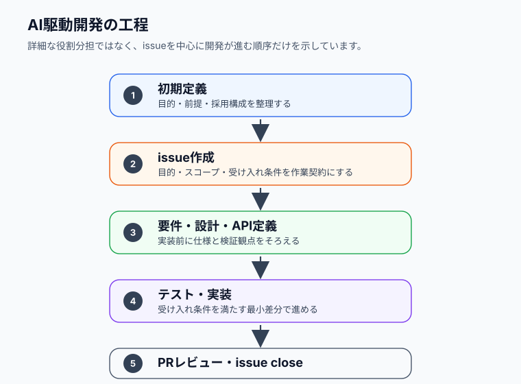

# AI Driven Development Template

AIエージェントと人間が、GitHub issueを作業契約として共有しながら開発を進めるための、**AI駆動開発向けテンプレート**です。

このテンプレートは、要件定義、設計、API定義、テスト、実装、PR作成までを issue 起点で進めることを前提にしています。営業デモ、要件確認、画面遷移確認、技術検証が必要な場合は、通常の本実装に入る前に任意でプロトタイプを作成し、動く試作品から得た知見を要件定義や設計へ反映できます。

また、要件、設計、API仕様、テスト観点、運用ルールをリポジトリ内のファイルとして管理する **Everything as Code** の考え方に沿っています。AIエージェントは、口頭の指示や暗黙知ではなく、GitHub issue と `docs/` 配下のドキュメントを根拠に作業します。

このファイルは、このテンプレート本体のREADME相当のドキュメントです。`README.md` は、テンプレート利用先プロジェクト用のREADME雛形として扱います。

## 全体像

このテンプレートは、GitHub issue を作業契約にして、人間とAIエージェントが同じ前提を読みながら開発を進めるためのものです。

## バージョンとリリース

- 公開済みstable: `v1.0.0`
- `main`: v2 development line
- 現在の目標version: ルート`VERSION`を参照
- 変更履歴: `CHANGELOG.md`
- release基準: `docs/common/versioning-policy.md`
- v1からv2への移行: `docs/common/migration-v1-to-v2.md`

v1はIssue、assignee、prompt、人間承認を中心とする軽量な文書駆動baselineです。v2はIssue #8のadaptive workflowとIssue #9のproject orchestrationを段階的に追加します。現在の`main`ではIssue成果物のschema v1、template、同梱例の形式テストとモジュール式ルールのオフライン解決libraryを提供します。計画・状態・再開候補の静的checkerも利用できます。追跡性checkerとBrownfieldの手順・深度別テンプレートも利用できます。オフラインGolden TestとIssue内部のActions統合も利用できます。Projectの3成果物schema・合成記入例・形式テストも利用できます。依存DAG・wave・計画改訂の読み取り専用validatorも利用できます。member/ownership/capacityのsnapshot検査も利用できます。手動Coordinatorの手順・コメント様式・机上例も利用できます。明示snapshotの進捗集約・不整合検出も利用できます。実GitHubの自動取得・推薦は後続実装です。工程の自動実行は提供しません。

template release versionと各成果物の`schema_version`は独立しています。template v2で最初に導入するschemaが`schema_version: 1`でも問題ありません。利用先projectでは、このrepositoryの`VERSION`をアプリケーションversionと混同しないでください。

### 開発フロー



## 目的

- issueを開発の最小単位として扱う
- AIが推測で実装しないよう、要件・設計・受け入れ条件を明文化する
- 実際に動くプロトタイプを使い、営業デモや要件・設計の解像度向上に活用する
- 要件、設計、API、テスト、運用ルールを Everything as Code として管理する
- GitHub Issue Form と GitHub Actions で作業契約の不足を検出する
- PRに対応issue、実行した検証、残課題を残す
- プロジェクトごとの `AGENTS.md` とツール別入口ファイルからAIエージェントへ規約を伝える

## 含まれるもの

- `.ai-workflow/templates/brownfield/v1/`: 読み取り専用調査のLow/Medium/HighのMD/YAML合成例
- `docs/common/brownfield-analysis-guide.md`: 調査scope・上限・High承認・停止・引き継ぎの手順
- `.ai-workflow/schemas/issue/v1/`: 共通定義と4種類のIssue成果物schema
- `.ai-workflow/templates/issue/v1/`: schemaに適合する合成YAML記入例
- `tests/workflow-schema/`: schema適合テストの正常・異常fixtureとcase一覧
- `.ai-workflow/schemas/trace-checks/v1/`と`.ai-workflow/templates/trace-checks/v1/`: 対応表検査の台帳・結果・抑制scope
- `tools/workflow-trace/`と`tests/workflow-trace/`: 5境界の追跡性・参照・期限付き抑制の検査とテスト
- `.ai-workflow/schemas/checks/v1/`と`.ai-workflow/templates/checks/v1/`: 検査context/result/state拡張の契約と例
- `tools/workflow-check/`と`tests/workflow-check/`: 計画・履歴・再開候補のread-only検査とテスト
- `.ai-workflow/schemas/rules/v1/`と`.ai-workflow/templates/rules/v1/`: rule/context/resolutionの契約と例
- `docs/common/rules/legacy/`: 既存2文書を維持するalways-on参照
- `tools/workflow-rules/`と`tests/workflow-rules/`: オフライン解決・plan投影と回帰テスト
- `tools/workflow-schema/`: Node.js 22以上を使用する独立した検証用パッケージ
- `README.md`: 利用先プロジェクト用READMEの雛形
- `VERSION`: template本体の現在の目標version
- `CHANGELOG.md`: template本体の変更履歴とrelease境界
- `AGENTS.md`: AIエージェント共通の入口
- `CLAUDE.md`: Claude Code向けの入口
- `.gitattributes`: Git上の改行コードとテキスト判定の基本設定
- `docs/common/development-rules.md`: AI向け開発規約
- `docs/common/adaptive-workflow-design.md`: Issue内部の適応的な実行計画、状態管理と再開、追跡性検査、モジュール式ルール、Brownfield解析、Golden Testの共通設計
- `docs/common/project-orchestration-design.md`: 複数feature、Issue、開発者、AIエージェントをまたぐ計画、割当、進捗、競合防止の共通設計
- `docs/common/versioning-policy.md`: template release、pre-release、schema version、保守branchの方針
- `docs/common/migration-v1-to-v2.md`: v1からv2への段階移行とfallback
- `docs/common/operations-manual.md`: 人間向けの具体的な運用手順
- `docs/common/quality-gates.md`: NFR、Security、Resiliency の品質ゲート
- `docs/common/template-guide.md`: テンプレート本体の説明、公開設定、利用時の読み替えガイド
- `docs/common/issue-template.md`: issue本文テンプレート
- `docs/architecture.md`: 利用先プロジェクトの採用アーキテクチャ、デフォルト構成との差分、設計判断
- `docs/prototype.md`: 営業デモ、要件確認、画面遷移確認、技術検証のためのプロトタイプ範囲と結果
- `docs/examples/issues/001-user-profile-edit.md`: issue記載例
- `.github/ISSUE_TEMPLATE/feature.yml`: GitHub Issue Form
- `.github/pull_request_template.md`: PRテンプレート
- `.github/workflows/issue-contract-check.yml`: issue契約チェック
- `.github/workflows/pr-issue-link-check.yml`: PR本文チェック

`docs/common/adaptive-workflow-design.md`の4.1～4.3が実装済みschemaの契約です。templateは実際のIDや状態へ置換して利用します。形式検証の成功は承認・工程完了・参照先の存在を保証しません。利用・検証コマンドは`docs/common/operations-manual.md`、移行・fallbackは`docs/common/versioning-policy.md`を参照してください。計画・状態・再開候補の意味検査は第5.4・6.4節のcheckerで提供します。対応表の網羅と参照は第7章の追跡性checkerで検査します。Projectの3成果物の形式はproject-orchestration-design第5.5節を参照してください。依存DAG・wave・改訂の検査は第8.4節のvalidatorで追加利用できます。member/ownership/capacityは第9.4節でsnapshotを追加検査できます。従来のIssueベース運用を維持します。

Issue内部の工程選択と再開はadaptive workflow、プロジェクト全体の開発順序、担当割当、進捗集約、AI主導の次Issue提案はproject orchestrationの責務です。後者の初期標準はIssues-onlyと手動Coordinatorであり、GitHub Projects、Dispatcher、外部Agent Runnerを必須にしません。

## テンプレート本体の運用

このテンプレートリポジトリ自体も、issueを起点に変更内容を管理します。

ただし、テンプレート本体はアプリケーションプログラムではないため、利用先プロジェクトと同じ要件定義、設計、API定義、実装、テストの全工程を必須とはしません。テンプレート本体の運用で従うのは、主に **issueで目的、スコープ、受け入れ条件、検証観点を明確にしてから変更する** という issue 運用です。

GitHubへ公開して Actions を有効にすると、テンプレート本体に対する issue や PR にも以下のチェックが働きます。

- issue作成・更新時に、Issue Formの必須項目が揃っているかを確認する
- 必須項目が揃っているissueには `ready-for-ai` ラベルを付ける
- 不足があるissueには `needs-info` ラベルを付け、確認コメントを追加する
- PR本文に `Closes #123` 形式の対応issueと `実行した検証` が含まれるかを確認する

テンプレート本体を変更するissueでは、例えば以下のように記載します。

- アプリ名: AI Driven Development Template
- 対象プラットフォーム: Documentation
- 目的: テンプレートガイドにテンプレート本体の運用方針を追記する
- スコープ: `docs/common/template-guide.md` の「テンプレート本体の運用」セクションを更新する
- 非スコープ: 利用先プロジェクトの開発規約やGitHub Actionsの仕様変更は含めない
- 受け入れ条件: テンプレート本体ではissue運用のみを適用することがテンプレートガイドから読み取れる
- テスト観点: テンプレートガイドの記載が現在の `.github/` ファイル構成と矛盾していないことを確認する
- 参照ドキュメント: `docs/common/template-guide.md`, `.github/ISSUE_TEMPLATE/feature.yml`, `.github/workflows/issue-contract-check.yml`

この運用により、テンプレート自体の改善も issue とPRの履歴として残せます。

## マルチエージェント運用

このテンプレートでは、マルチエージェント運用を特定ツール専用の機能ではなく、Codex、Claude Code、その他AI開発ツールを含む一般ルールとして扱います。

`ready-for-ai` はAIに依頼できる状態を示すラベルであり、自動着手や担当確定を意味しません。AIエージェントに作業させるissueには、事前に担当（assignee）を設定します。ここでいう担当（assignee）は、issueの責任を持つ人間のGitHubアカウントです。

人間は、通常のissue依頼時にマルチエージェント機能を意識する必要はありません。AIが必要性を判断し、有効な場合は分割案を提示します。人間が承認した場合にのみ、複数エージェントで作業します。

1つのissueを複数エージェントに分割する場合は、primary agentまたは統合担当者、各エージェントの担当範囲、変更予定ファイルを事前に明確にします。

具体的な運用手順は `docs/common/operations-manual.md` を参照してください。

## GitHubを使わない場合

このテンプレートは、GitHub Issues、Pull Request、GitHub Actions を使う運用を標準としています。

GitHubを使わないプロジェクトでは、利用する管理ツールに合わせて、以下の対応関係を決めてから運用してください。

- GitHub issue に相当する作業単位。
- issue番号に相当するID。
- `ready-for-ai` ラベルに相当する状態、タグ、カスタムフィールド。
- 担当（assignee）に相当する担当者フィールド。
- Pull Request に相当するレビュー単位。
- `Closes #123` に相当する完了リンクまたは参照形式。
- GitHub Actions によるチェックに相当する確認方法。

例:

- Jira / Linear / Backlog のチケットを作業契約として扱う。
- Notion / Markdown ファイルで `docs/common/issue-template.md` 相当の項目を管理する。
- `ready-for-ai` はステータス、タグ、カスタムフィールドで表現する。
- 担当（assignee）は担当者フィールドで表現する。
- Pull Request がない場合は、Merge Request、変更レビュー記録、レビュー済みコミットで代替する。

GitHubを使わない場合でも、以下の原則は維持してください。

- 作業単位を明確にする。
- 作業契約に目的、スコープ、非スコープ、受け入れ条件、検証観点を書く。
- アーキテクチャ設計を `docs/architecture.md` 相当のドキュメントに残し、デフォルト構成から外れる場合は理由と承認結果を書く。
- 営業デモや要件確認のためにプロトタイプを作る場合は、`docs/prototype.md` 相当のドキュメントに範囲、差分、検証結果、後続issue候補を残す。
- 多言語対応を今すぐ行わない場合でも、ユーザー向け文言はメッセージ定義ファイルへ集約する。
- AIに依頼できる状態を明確にする。
- 担当者を明確にする。
- AIは作業契約外の変更をしない。
- 完了時に検証結果と残課題を残す。

### GitHubを使わない場合に編集するファイル

GitHubを使わない場合は、以下のファイルに含まれる GitHub 固有の表現を、利用する管理ツールに合わせて書き換えてください。

AIが読むファイル:

- `AGENTS.md`
  - `GitHub issue本文` を、利用する管理ツールの作業チケット、タスク、または `docs/issues/*.md` に置き換える。
  - `ready-for-ai` ラベルを、管理ツール上のステータス、タグ、カスタムフィールドに置き換える。
  - `担当（assignee）` を、管理ツール上の担当者フィールドに置き換える。
  - `PR本文` や `Closes #123` を、利用するレビュー・完了記録の形式に置き換える。
- `docs/common/development-rules.md`
  - `GitHub issue`、`GitHub Issue Form`、`ready-for-ai`、`担当（assignee）`、`PR`、`Closes #123` などの用語を、利用する管理ツールの用語へ置き換える。
  - AIが作業開始時に確認する作業契約の場所を明記する。
  - AIが完了時に検証結果や残課題を残す場所を明記する。
- `CLAUDE.md`
  - Claude Codeを使う場合、`GitHub issue本文` や `ready-for-ai` の参照先を、利用する管理ツールに合わせて置き換える。
- `docs/common/issue-template.md`
  - GitHub issue番号またはURLの欄を、チケットID、タスクURL、またはMarkdownファイルパスに置き換える。
  - 管理ツールで入力する項目名に合わせる。

人間向けの運用ファイル:

- `docs/common/operations-manual.md`
  - GitHub issue作成、PR作成、GitHub Actions確認の手順を、利用する管理ツールとCIの手順へ置き換える。
  - 人間がAIへ依頼するときのプロンプト例を、GitHub issue番号ではなく、チケットIDやファイルパスを渡す形に変更する。
- `docs/common/template-guide.md`
  - テンプレート公開元README相当の説明として、GitHub以外の運用を正式に採用する場合は、その前提を追記する。

GitHub専用ファイル:

- `.github/ISSUE_TEMPLATE/feature.yml`
- `.github/pull_request_template.md`
- `.github/workflows/issue-contract-check.yml`
- `.github/workflows/pr-issue-link-check.yml`

GitHubを使わない場合、これらはそのままでは機能しません。不要なら削除し、利用する管理ツールやCIに合わせて代替ファイルを用意してください。

## デフォルト構成

`docs/common/development-rules.md` では、特に理由がない場合に採用するデフォルト構成として以下を定義しています。

- Frontend: Flutter または Next.js
- Backend: Hono
- Infrastructure: AWS CDK v2
- Runtime: AWS Lambda + AWS Lambda Web Adapter
- Auth / Hosting: AWS Amplify

利用先プロジェクトでは、STEP 0で `docs/system-context.md` とあわせて `docs/architecture.md` を作成し、デフォルト構成を採用するか、要件や制約に応じて別構成にするかを判断します。デフォルト構成から外れる場合は、採用理由、比較した選択肢、影響範囲、未決事項、人間の承認結果を `docs/architecture.md` に記録してください。

営業デモや要件確認のために、STEP 0の後に任意でプロトタイプを作成できます。プロトタイプは `docs/system-context.md` と `docs/architecture.md` を入力にし、`docs/prototype.md` に目的、再現する範囲、再現しない範囲、本番アーキテクチャとの差分、検証結果、後続issue候補を記録します。プロトタイプは本番実装として扱わず、得た知見を要件定義、設計、API定義、アーキテクチャ設計、または後続issueへ反映してから本実装へ進めます。

ユーザーに表示する文言は、画面、バリデーション、エラー、通知、メール文面を含めてメッセージ定義ファイルまたはメッセージ管理モジュールに集約します。多言語対応を今すぐ行わない場合でも、後から言語を追加できるキー設計にしてください。APIは表示文言そのものではなく、可能な限り安定したエラーコードを返し、Frontend側で表示文言に変換します。

実際のプロジェクトで使う技術スタックは、最初に `docs/architecture.md` へ明記してください。

## AIエージェントへの依頼方法

作業を依頼するときは、GitHub issue本文またはissue番号を起点にしてください。

例:

```text
issue #123 に着手します。
AGENTS.md、docs/common/development-rules.md、docs/system-context.md、docs/architecture.md、issue本文を読み、
目的、受け入れ条件、影響範囲、不明点、実装前に更新すべきドキュメントを報告してください。
```

`ready-for-ai` ラベルがないissueは、実装前に不足情報を確認する運用を推奨します。

## ライセンス

MIT License

## ワークフローのGolden Test

`tools/workflow-golden/`と`tests/workflow-golden/`は、固定した合成入力から既存checkerを呼び、期待見本・禁止結果と比較する追加の開発ツールです。
アプリケーションの言語に依存せず、PCやCIのNode.js 22以上で動きます。アプリや本番環境へのNode.js導入は不要です。
対象システム自身のテストは各言語の仕組みで別途実行します。

利用時は`.ai-workflow/schemas/`、既存の`tools/workflow-{rules,check,trace}/`、新しい`tools/workflow-golden/`と`tests/workflow-golden/`をまとめて保持します。
既存checkerと新パッケージそれぞれの依存を導入した後、テスト中の外部通信はありません。
セットアップ、実行、fixture契約、見本の手動更新、失敗時の扱いは[運用マニュアル](operations-manual.md#golden-testの実行)を参照してください。
Golden Testの成功は同梱例の回帰確認であり、利用先Issueの承認・完了・安全性の証明ではありません。GitHub Actions接続は利用可能で、AI意味評価は後続実装です。

## GitHub Actionsへの接続

`Workflow Validation`は全PR/main更新/手動操作でテンプレートの静的テスト・Golden Testと保存Issue成果物を検査します。
既存2workflowとは独立し、UbuntuのNode.js 22/24、contents:read、credential非保持で動きます。
必要な7tool package（schema/rules/check/trace/golden/ci/project）、tests、.ai-workflow/schemas、workflowをまとめて保持してください。
アプリ自身のテストは別途用意します。Secrets/自動承認/merge/deploy/AI評価は追加しません。
導入・結果の見方・未評価・無効化・required checkの段階導入は運用マニュアルの「GitHub Actionsでのワークフロー検査」を参照してください。

## Project成果物の追加利用

Project設定・開発計画・人間のメンバー台帳の記入例は`.ai-workflow/templates/project/v1/`、正本schemaは`.ai-workflow/schemas/project/v1/`です。
既存Issue共通schemaとworkflow-schemaの依存を使い、Issues-only/manualの形式を確認できます。
`npm run test:project --prefix tools/workflow-schema`は同梱例の形式テストで、既存CIでも実行します。
利用先の保存Projectファイルのruntime検査、依存・member・権限の意味検査、割当やclaim操作を提供するものではありません。
採用時は実案件へ明示置換し、人間がレビューします。詳しくは記入例README、運用マニュアル、project-orchestration-design第5.5節を参照してください。
## Project計画の意味検査を追加する

`tools/workflow-project/`、`tests/workflow-project/`と`.ai-workflow/schemas/`全体、既存workflow-rulesを保持します。canonical/digestの再利用にもrules schemaが必要です。
`checkProjectPlan`は依存DAG、ID、共有area、計画revisionを読み取り専用で検査し、waveと待機理由を返します。
`loadProjectPlan`は明示pathだけを読みます。保存Projectの自動探索やGitHub照会、担当・claim操作は行いません。
確認snapshotは入力revision/digestに結び付けますが、人間本人・実権限・事実の鮮度を認証しません。scope非重複を確認できない共有領域は保守的に直列化します。
`npm test --prefix tools/workflow-project`は専用テストで、既存CIにも接続しています。Project全体Goldenは後続対応です。
実案件への入力方法、結果の読み方、改訂・復旧は運用マニュアル、契約と上限はproject-orchestration-design第8.4節を参照してください。

## メンバーと担当条件の追加検査

`tools/workflow-project/`のmember検査、`tests/workflow-members/`、`.ai-workflow/schemas/`全体と既存workflow-rulesを保持します。
`checkProjectMembers`は指定人間1人のmembership/役割/area/権限/必要Team、Coordinator・統合責任、active claimに基づく同時担当数を検査します。
`loadProjectMembers`はproject/team/contextの明示pathだけを読みます。確認snapshotは対象台帳のrevision/digestに結び付けますが、実API取得・本人認証・権限付与・担当/claim変更は行いません。
`npm run test:members --prefix tools/workflow-project`は専用の合成テストで、既存CIのNode22/24でも実行します。Project全体Goldenや保存Projectの自動走査とは区別します。
実案件への明示導入、candidate/assigned_owner、bot代理・所有上書き・capacity・結果の見方は運用マニュアルの「指定した人間の担当条件を検査する」、契約と上限はproject-orchestration-design第9.4節を参照してください。

## 手動Coordinator運用を追加する

[手順](manual-coordinator.md)、[コメント様式v1](../../.ai-workflow/templates/project-manual/v1/README.md)、[机上例](../examples/project-manual/walkthrough.md)をまとめて参照します。
担当割当、着手記録、進捗、解除/再割当、Coordinator交代、部分失敗の照合を、人間がGitHub Issue上で記録します。
status_mappingとheartbeat/stale方針は導入時に合意し、操作の実状を読み戻します。stale/blocked/inactiveでも自動解放しません。
任意導入で、従来の単一Issue運用は継続できます。様式v1は人間向けMarkdownの版であり、既存schema/checker/CIに新しい機械契約を追加しません。
自動割当・原子的claim・集約/recommender・Project全体Goldenは含みません。実案件の同時操作やAPI障害復旧は机上確認の保証範囲外です。

## Project進捗の読み取り専用集約

`tools/workflow-project/`のaggregate用modules、`tests/workflow-aggregate/`、`.ai-workflow/schemas/project-aggregate/v1/`を、既存rules/check/project・schemaと一緒に参照します。
`aggregateProject`は明示GitHub確認snapshotと既存checkWorkflowの元入力を再検査し、Issue/featureの現在地・保守的状態・不整合・event checkpointを返します。
`loadProjectAggregate`は列挙pathだけを読みます。人間向けコメントを解析せず、通信・Git・自動保存・担当/状態変更は行いません。
`npm run test:aggregate --prefix tools/workflow-project`は同梱合成テストです。実案件の取得方法や本人性を証明するものではありません。
実行例・元入力・checkpoint/復旧は[運用マニュアル](operations-manual.md)、契約はproject-orchestration-design第13.0節を参照します。任意導入で、単一Issue運用も継続できます。

## 安全な次作業の提案を追加する

`tools/workflow-project/recommend.mjs`は確認済み元入力を既存checkerで再検査し、本人の既存作業またはCoordinatorへ相談する候補を決定的に返します。担当・claim・工程を自動実行しません。
`recommend-load.mjs`と`project-recommend/v1`の独立context/result、[合成入力](../../tests/workflow-recommend/fixtures/README.md)を任意で導入します。初回依存導入後はオフラインのNode.js 22以上で動き、開発対象の言語には依存しません。
利用方法・確認項目・停止/復旧・上限・not_evaluatedは[運用マニュアル](operations-manual.md)を参照してください。専用合成テストは`npm run test:recommend --prefix tools/workflow-project`で実行し、CIのNode22/24でも検証します。保存Project走査・Project全体Goldenは別途対応です。

## Projectの統合Golden Test

計画・member・集約・推薦の固定運用例も既存Goldenハーネスで検証します。既存12caseと新25caseの計37caseが対象で、既存Workflow ValidationのNode22/24でも同じ命令を実行します。
新しいProject adapterを読み込むため、Golden利用時に既存workflow-projectの依存も導入します。tool/fixtureは同じtemplate commitの一式を保持し、25必須caseを落としたsuiteを成功としません。利用先Projectの設定・成果物保存を強制するものではありません。
[運用マニュアル](operations-manual.md)と[固定例](../examples/project-golden/README.md)に導入、比較/禁止条件、手動見本更新、停止時の復旧、第16章14観点との対応・保証境界を記載しています。実GitHub操作・原子的claim・実Dispatcher障害やアプリ自身のテストは含みません。
