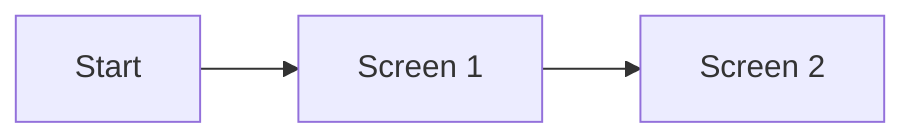

# Prototype

このドキュメントは、営業デモ、要件確認、画面遷移確認、技術検証のために作成するプロトタイプの範囲と結果を記録するためのテンプレートである。

プロトタイプは本番実装ではない。プロトタイプで得た知見は、後続issue、要件定義、設計、API定義、アーキテクチャ設計へ反映してから本実装へ進める。

## 目的

該当するものを残し、具体的な目的を書く。

- 営業デモで実際に動く画面を見せる。
- ユーザーフローや画面遷移を確認する。
- 要件定義や設計の解像度を上げる。
- 技術的な実現可能性を検証する。
- TBD

## 入力ドキュメント

- `docs/system-context.md`
- `docs/architecture.md`
- 関連issue:
- 参考資料:

## 再現する範囲

プロトタイプで実際に動かす範囲を書く。

- 画面:
- 画面遷移:
- 入力フォーム:
- ダミーデータ:
- 主要な成功体験:
- 主要な異常系:

## 再現しない範囲

プロトタイプで作らない範囲を書く。

- 本番認証:
- 本番DB:
- 決済:
- 外部API:
- 権限管理:
- 監査ログ:
- Infrastructure:
- その他:

## 本番アーキテクチャとの差分

`docs/architecture.md` の採用構成と異なる点を書く。差分がない場合は「差分なし」と書く。

- Frontend:
- Backend:
- Data Store:
- Auth:
- External Services:
- Infrastructure:

## 画面 / ユーザーフロー

プロトタイプ前に大枠を仮決めし、プロトタイプ後に見直す。

## プロトタイプで判明したこと

- TBD

## 要件・設計へ反映すること

- `docs/requirements/`:
- `docs/design/`:
- `docs/api/openapi.yaml`:
- `docs/architecture.md`:
- `docs/system-context.md`:

## 後続issue候補

- [ ] TBD

## 検証方法

- 起動コマンド:
- 確認した画面:
- 確認した操作:
- 未検証:

## 廃棄 / 流用方針

プロトタイプコードを本実装へ流用するか、破棄するかを書く。流用する場合は、品質、テスト、セキュリティ、アーキテクチャ適合性を再確認する。

- 方針: 破棄 / 一部流用 / 本実装へ昇格候補
- 理由:
- 必要な追加対応:
